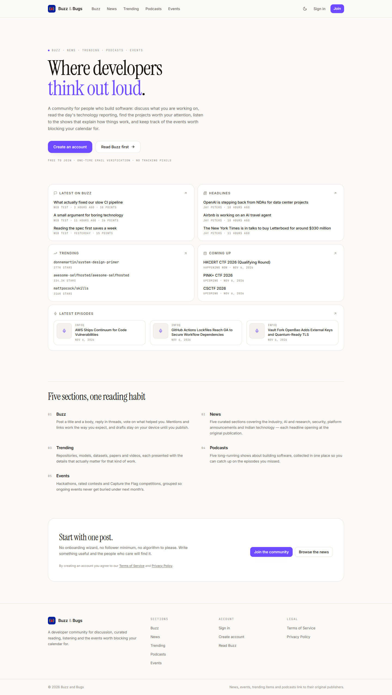
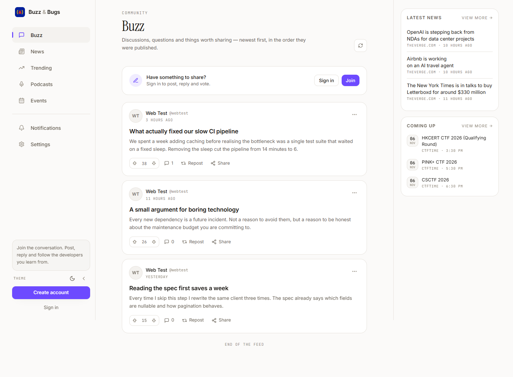
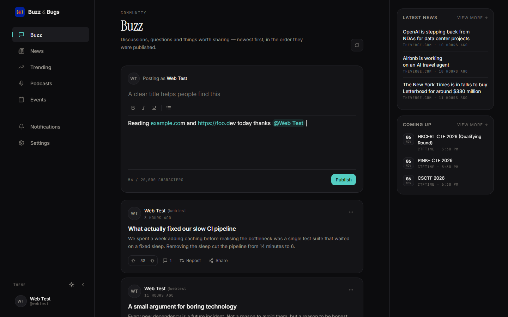
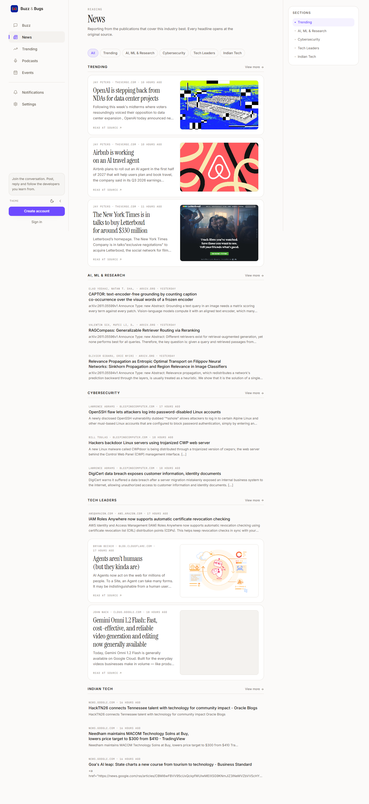
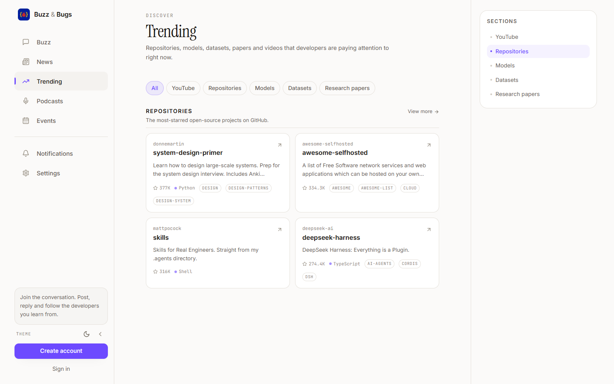
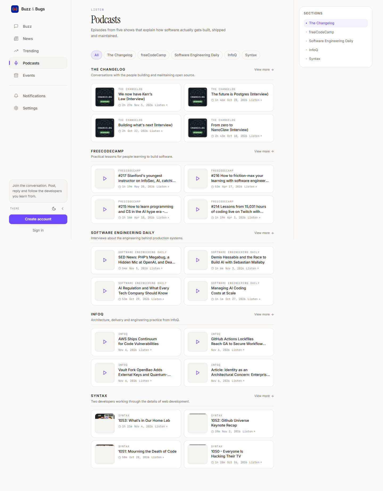
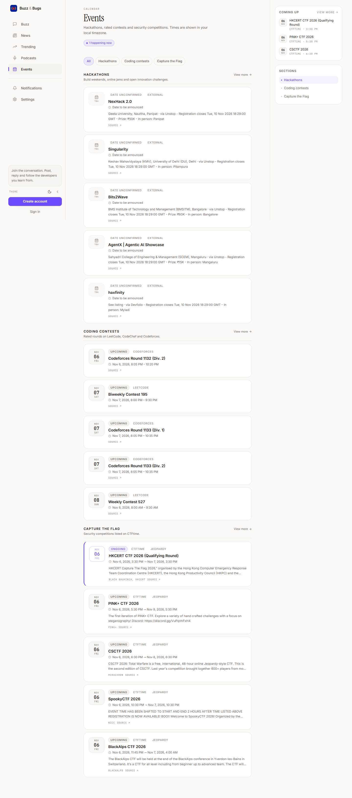
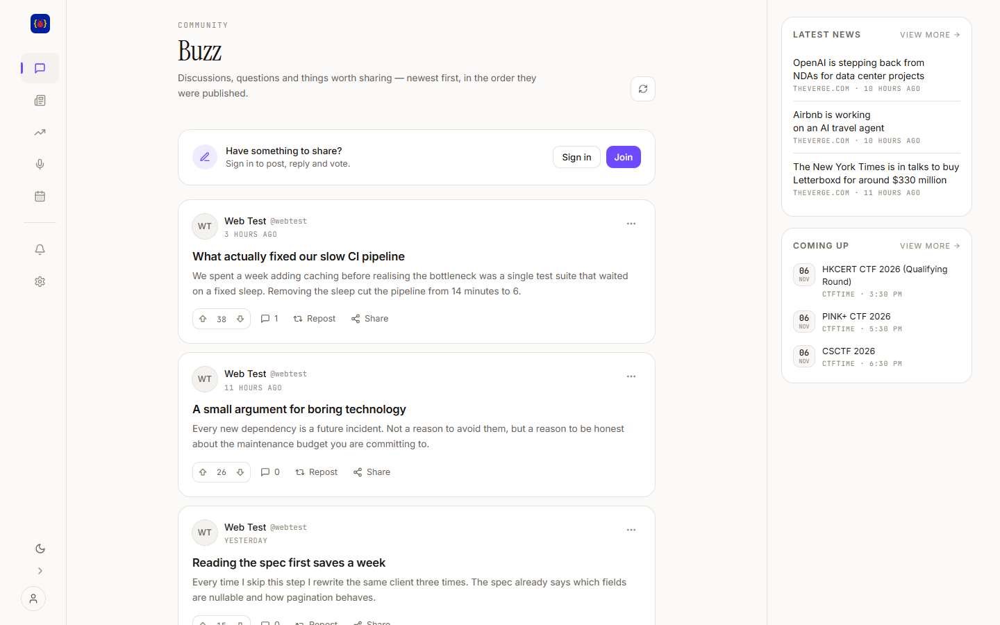

# Buzz and Bugs

**A developer community that respects your attention.**

Buzz and Bugs brings the four things developers actually check every day — conversation, news,
open-source discovery and upcoming events — into one calm place, and adds the podcasts worth
listening to while you work.

It is not a social network optimised for engagement, and it is not a link aggregator that rewards
whoever posts first. There is no infinite recommendation engine, no advertising, and no tracking
pixels. The feed is chronological. The news opens at the publication that wrote it. The events are
sorted by when they happen.



---

## The problem it solves

Developer information is scattered across a dozen surfaces. Discussion lives in one place, the
day's reporting in another, the repositories and papers you meant to read in a third, and the
hackathon you missed because it was announced on a platform you don't check. Podcasts are worse:
five shows, five players, five backlogs.

Buzz and Bugs puts those in one reading habit, with a single account and a consistent interface —
and then gets out of the way. It is deliberately small: five sections, one feed, no gamification
beyond a vote score.

## Who it is for

- **Developers who read** more than they post, and want the day's signal without the noise.
- **People learning in public** who want a place to ask a specific question and get a specific
  answer, without their post disappearing into an algorithmic void.
- **Anyone who ships side projects** and wants to find the library, dataset or paper that solves
  the problem they are stuck on.
- **Students and early-career engineers** keeping an eye on hackathons, contests and CTFs.

---

## The five sections

### Buzz — the conversation

A chronological feed of posts and replies. Write a title and a body, format it lightly, mention
people with `@`, and paste links — they become links automatically. Vote on what helped you,
repost what deserves a wider audience, and follow the people whose answers you trust.



Every post has its own page with threaded replies, a reply composer, sharing, and the moderation
controls that apply to you. Your draft is kept on your device until you publish it, so a closed tab
never costs you a paragraph.



Links are detected as you type or paste — `example.com`, `www.example.com` and full URLs all become
links — and typing `@` opens a searchable list of people to mention.

### News — the day's reporting

Five curated sections: **Trending**, **AI, ML & Research**, **Cybersecurity**, **Tech Leaders** and
**Indian Tech**. Articles with artwork are presented as feature cards; text-only stories stay
compact, so the page reads like a publication rather than a grid of identical boxes.



The order is stable: newest first, and it does not reshuffle when you reload. Every headline opens
at the original publisher.

### Trending — what the community is watching

Repositories, models, datasets, research papers and videos, each shown with the details that matter
for that kind of work — stars and language for a repository, likes and pipeline for a model,
downloads and tags for a dataset, authors and date for a paper.



### Podcasts — the listening queue

Five shows, one place: **The Changelog**, **freeCodeCamp**, **Software Engineering Daily**,
**InfoQ** and **Syntax**. Each has its own section, its own artwork, and the newest episodes first.



Podcasts are a first-class section rather than a corner of Trending, so you can go straight to the
show you want and pick up where you left off.

### Events — the calendar that matters

Hackathons, coding contests and Capture the Flag competitions, with ongoing events clearly separated
from upcoming ones and times shown in your own timezone.



---

## What you can do with an account



- **Publish** posts and threaded replies, with automatic link detection and `@` mentions.
- **Vote, repost and follow** — the feed stays chronological; following does not reorder it.
- **Collapse the sidebar** to an icon rail when you want the page to yourself; the choice is
  remembered on that device.
- **Build a profile**: display name, short biography, links to your other work, and a picture.
- **Control your privacy**: choose which parts of your profile are public.
- **Shape your reading**: switch theme and accent colour, and reorder the sections you care about.
- **Manage your account**: review active sessions, sign out everywhere, change your password, or
  delete your account with a seven-day recovery window.
- **Appeal a moderation decision** privately, with a link sent only to you.

## How moderation works

Moderation is report-driven. Every post publishes immediately; nothing is checked up front. When
someone reports a post, it is checked against the platform's content policy. If it passes, the post
stays up and nobody is told anything — not the author, not the moderators — and the report is
deleted. If it fails, the post is hidden and the author alone is notified, with a seven-day appeal
link. After seven days without an appeal, or if an appeal is rejected, the post is deleted
permanently together with its replies and reposts. Appeals are read by a person, and a restored post
keeps everything it had before. An unappealed removal leaves only the warning on the account; a
decided appeal keeps the post title and the decision for thirty days.

Reports are rate-limited, and a revision that has just been cleared is not checked again straight
away, so the report button cannot be used to generate work.

---

## Access

The hosted instance is available at **[deployment URL]**.

To run it yourself, you need the backend running locally. From this folder:

```bash
npm install
npm run dev
```

Then open <http://localhost:3000>. Backend setup, database and email configuration are documented in
the backend repository.

---

## Status

Actively developed. The platform is fully functional across Buzz, News, Trending, Podcasts, Events,
profiles, notifications, settings and the admin console. Features that the API does not support —
full-text search, a "following" feed filter, direct messages — are intentionally absent rather than
faked.

## Contact

Questions, bug reports and suggestions: **[contact email]**.
